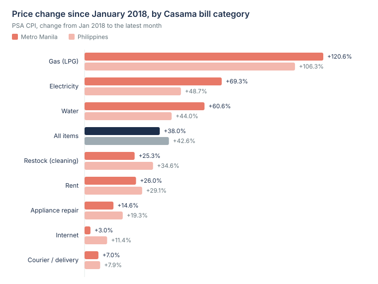
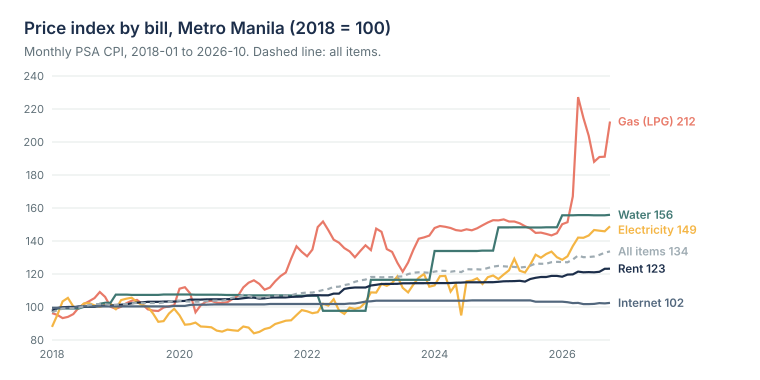
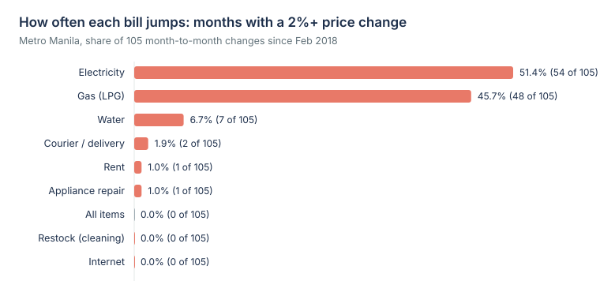
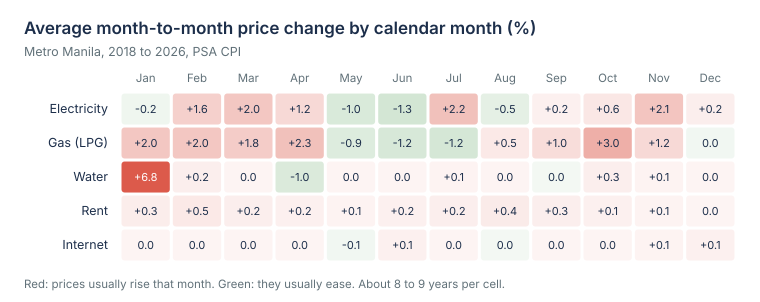
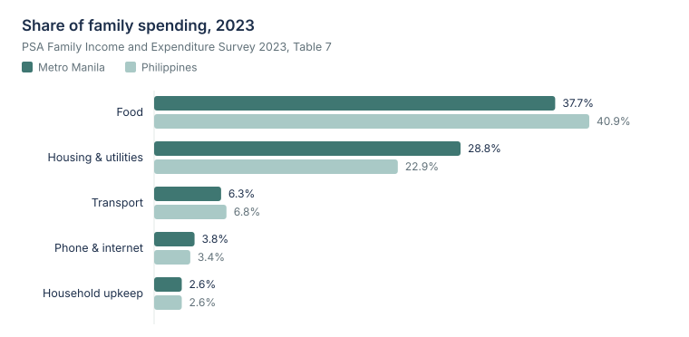

# Casama Bill Pulse

**Which shared-household bills rise fastest, and which are hardest to predict?**

Data Science Final Project, built with the 3rd-year App Development team behind
**Casama**, a shared-living app (app documentation: [APP_README.md](APP_README.md)).
Data: Philippine Statistics Authority (PSA) OpenSTAT API, January 2018 to October 2026.

| | |
|---|---|
| **Team** | _[Member 1]_, _[Member 2]_, _[Member 3]_, _[Member 4]_ |
| **Course** | _[Course code, Data Science]_ |
| **Instructor** | _[Professor's name]_ |
| **Partner project** | Casama (3rd Year, Application Development) |
| **Presentation format** | ASEAN Data Science Explorers (problem → data → analysis → insights → recommendations → impact) |
| **Interactive dashboard** | _[paste the shared dashboard link here]_ |
| **Video** | _[paste the video link here]_ |

---

## Contents

1. [Summary](#1-summary)
2. [Background: the Casama app](#2-background-the-casama-app)
3. [Problem statement and objectives](#3-problem-statement-and-objectives)
4. [Dataset](#4-dataset)
5. [Methodology](#5-methodology)
6. [Findings](#6-findings)
7. [Recommendations for Casama](#7-recommendations-for-casama)
8. [Reusing the API in the app](#8-reusing-the-api-in-the-app)
9. [How to run](#9-how-to-run)
10. [Output files and data dictionary](#10-output-files-and-data-dictionary)
11. [Limitations](#11-limitations)
12. [Project structure](#12-project-structure)
13. [References](#13-references)

---

## 1. Summary

Casama's Bill Tracker lets housemates split rent, water, electricity, LPG and internet.
We matched each of those bill categories to the official Consumer Price Index (CPI) from
the PSA API and analysed 106 months of prices for Metro Manila and the whole Philippines.

**Key findings (Metro Manila, Jan 2018 to Oct 2026):**

1. **Utilities rose much faster than prices overall.** LPG **+120.6%**, electricity
   **+69.3%** and water **+60.6%**, against **+38.0%** for all items. Rent rose **+26.0%**
   and internet only **+3.0%**.
2. **Electricity and LPG are the unpredictable bills.** Electricity's price changed by 2% or
   more from the previous month in **54 of 105 months**, and LPG in **48**. Rent did so
   **once**, and internet **never**.
3. **Some increases come at the same time every year.** Water prices rise in steps each
   January (average **+6.78%** in January). Electricity tends to rise in July (**+2.22%**).
4. **Metro Manila households are more exposed.** They spend **28.8%** of their budget on
   housing and utilities, against **22.9%** nationally (FIES 2023).

**Recommendation:** add a "price pulse" to Casama's Bill Tracker that uses this API to
estimate next month's bill, flag bills that rise faster than prices, and warn housemates
before high-risk months.

---

## 2. Background: the Casama app

Casama is a Flutter + Supabase mobile app for shared dorms, apartments and boarding
houses. Its features include home/out presence, a delivery and COD board, lost and found,
maintenance and restock tasks, chore roulette, group chat, and a **Bill Tracker** with
these categories (`BillCategory` in [`lib/data/models.dart`](lib/data/models.dart)):

`electricity`, `water`, `internet`, `appliance`, `rent`, `associationDues`, `gas`,
`maintenanceFee`, `other`

The app records each household's own bills, but it has no outside context: it can't tell
whether a higher bill reflects higher prices or higher usage, or whether one is coming.
This project adds that context from public data.

---

## 3. Problem statement and objectives

**Problem.** In shared living, disputes over money start less with rent than with
utility bills that change without warning. A fair split is easy when everyone knows what
is coming and hard when a bill arrives much higher than last month.

**Research questions**

1. Which of Casama's bill categories have risen fastest since 2018, and faster than
   prices overall?
2. Which categories change unpredictably from one month to the next?
3. Do price increases follow a calendar pattern that the app could warn about?
4. How much of a household's budget do these bills take, and where?

**Objectives**

- Find a public, reusable **API** dataset relevant to the Casama app.
- Build a repeatable pipeline that pulls, cleans and analyses it.
- Turn the findings into features the Casama team can build.

**Related goals:** UN SDG 11 (Sustainable Cities and Communities) and SDG 1 (No Poverty),
through the cost pressure on urban renters and students.

---

## 4. Dataset

### 4.1 Source

**PSA OpenSTAT** is the Philippine Statistics Authority's public statistics database. It
exposes a **PX-Web REST API**: free, no API key, updated monthly.

- Base URL: `https://openstat.psa.gov.ph/PXWeb/api/v1/en/DB`
- `GET <table>` returns the table's dimensions and codes.
- `POST <table>` with a JSON selection returns the data.

| Table | API path | Coverage | Used for |
|---|---|---|---|
| CPI for All Income Households by Commodity Group (2018 = 100) | `2M/PI/CPI/2018NEW/0012M4ACP22.px` | Monthly, Jan 2018 to latest; 354 items; national, 17 regions, provinces | Findings 1–3 |
| FIES 2023, Table 7: Total Annual Family Expenditure by Major Expenditure Group | `1E/IE/0071E3ATME0.px` | 2023; national, regions, provinces, cities | Finding 4 |

**Why this dataset fits the brief**

- **Relevant to the app:** it matches Casama's bill categories almost one-to-one (4.2).
- **An API that can be reused and repurposed:** the same request works for any region, any
  of 354 items and any month. New months appear about five days after a month ends, with
  no code changes.
- **Official and trustworthy:** it is the government's own inflation statistic.

### 4.2 Mapping Casama features to CPI items

| Casama feature / `BillCategory` | PSA CPI item code | CPI item name |
|---|---|---|
| Rent (`rent`) | `04.1.1.0` | Actual rentals paid by tenants for main residence |
| Water (`water`) | `04.4.1.1` | Water supply through network systems |
| Electricity (`electricity`) | `04.5.1.0` | Electricity |
| Gas (`gas`) | `04.5.2` | Gas (household fuel gas, mainly LPG) |
| Internet (`internet`) | `08.3.3.0` | Internet access provision services |
| Appliance (`appliance`) | `05.3.3.0` | Repair, installation and hire of household appliances |
| Restock tasks | `05.6.1.1` | Household cleaning and maintenance products |
| Delivery & COD board | `07.4.1` | Postal and courier services |
| Benchmark | `0` | All items (overall inflation) |

### 4.3 Data collected

- **Regions:** Philippines (national) and National Capital Region (Metro Manila), where
  most of Casama's target users (students and young workers in shared housing) live. Any
  other region can be added with one argument (section 9).
- **Period:** January 2018 to October 2026, 106 months per series.
- **Size:** 2 regions × 9 items × 106 months = 1,908 monthly observations, plus 10 FIES
  spending shares.

---

## 5. Methodology

### 5.1 Pipeline

```
PSA OpenSTAT API ──► 1. Query ──► 2. Clean ──► 3. Analyse ──► 4. Visualise ──► 5. Reuse
                     POST JSON     tidy rows     metrics       SVG charts       app feature
                     selection     per month     per bill      + dashboard      (estimator)
```

1. **Query** (`data_science/psa_client.py`). Read the table's dimensions with `GET`, translate labels
   such as `"04.5.1.0"` or `"PHILIPPINES"` into the table's codes, then `POST` a selection
   of regions, items and the 12 months (excluding PSA's annual-average column).
2. **Clean.** Convert the response into one row per region, bill and month
   (`period = YYYY-MM`), drop months PSA hasn't published yet, convert text to numbers, and
   sort by date. PSA's `json-stat2` output returns a placeholder value instead of data, so
   the client uses PSA's native `json` format.
3. **Analyse** (`data_science/casama_bills_analysis.py`). Compute the metrics in 5.2 for each region and
   bill.
4. **Visualise** (`data_science/make_charts.py`). Draw the five SVG charts in this README; the
   interactive dashboard uses the same output files.
5. **Reuse.** Apply the results to a bill estimator (section 7) that the app can adopt.

### 5.2 Metrics

For a monthly index series $I_t$:

| Metric | Formula | Meaning |
|---|---|---|
| Cumulative change | $\left(\dfrac{I_{\text{last}}}{I_{\text{Jan 2018}}} - 1\right)\times 100$ | How much the price rose over the whole period |
| Year-on-year change | $\left(\dfrac{I_t}{I_{t-12}} - 1\right)\times 100$ | Change against the same month last year; "latest" is Oct 2026 and "average" is the mean of all months |
| Month-on-month change | $m_t = \left(\dfrac{I_t}{I_{t-1}} - 1\right)\times 100$ | Change from the previous month |
| Typical monthly swing (volatility) | $\sigma(m_t)$ | Standard deviation of month-on-month changes: higher means less predictable |
| Jump frequency | share of months with $\lvert m_t\rvert \ge 2\%$ | How often the bill moves sharply |
| Calendar-month pattern | mean of $m_t$ for each calendar month | Months in which prices usually rise or ease |
| Peak month | calendar month with the highest mean $m_t$ | When to expect the biggest rise |

**Bill estimator.** For last month's bill $B$, the next month's calendar-month mean
$\bar m$ and volatility $\sigma$:

$$\hat B = B\,(1 + \bar m/100), \qquad \text{range} = B\,(1 + (\bar m \pm \sigma)/100)$$

---

## 6. Findings

All figures are Metro Manila unless stated. The full table for both regions is in 6.5.

### Finding 1: LPG, electricity and water rose much faster than prices overall



| Bill | Metro Manila | Philippines |
|---|---|---|
| Gas (LPG) | **+120.6%** | +106.3% |
| Electricity | **+69.3%** | +48.7% |
| Water | **+60.6%** | +44.0% |
| All items (benchmark) | +38.0% | +42.6% |
| Rent | +26.0% | +29.1% |
| Internet | +3.0% | +11.4% |

- LPG prices have more than doubled since 2018, and are **+47.2%** against a year ago.
- In Metro Manila, utility prices rose faster than the national average even though
  overall prices rose more slowly there (+38.0% vs +42.6%).
- Rent, cleaning supplies, appliance repair, internet and courier fees all rose **slower**
  than overall inflation.



The line chart shows *how* each bill rises. LPG and electricity zig-zag month to month.
Water climbs in flat steps. Rent and internet are nearly smooth lines.

### Finding 2: Electricity and LPG jump without warning; rent and internet hardly move



| Bill | Months with a 2%+ change | Typical monthly swing |
|---|---|---|
| Electricity | **54 of 105 (51.4%)** | ±4.12% |
| Gas (LPG) | **48 of 105 (45.7%)** | ±4.97% |
| Water | 7 of 105 (6.7%) | ±2.78% |
| Rent | 1 of 105 (1.0%) | ±0.43% |
| Internet | 0 of 105 | ±0.20% |

**This is the central finding.** In about one month in two, Metro Manila's electricity
price moves by 2% or more. Its swing is also more than twice the national figure (±4.12%
vs ±1.90%). The year-on-year change in electricity ranged from **−20.0%** (June 2024) to
**+27.4%** (June 2025). Rent and internet are nearly flat month to month.

**Implication for Casama:** a fixed split works for rent and internet. Electricity and LPG
are where surprises, and disputes, come from.

### Finding 3: Some increases arrive in the same months every year



- **Water rises in January.** The index stays flat for most of the year and then steps up
  at the start of the year: Jan 2019 (102.6 → 107.5), Jan 2023 (97.7 → 116.5), Jan 2024
  (116.5 → 134.0), Jan 2025 (134.2 → 148.3) and Jan 2026 (148.3 → 155.6). This is
  consistent with water tariffs being adjusted at the start of each year.
- **Electricity** tends to rise in **July (+2.22%)**, **March (+2.03%)** and
  **November (+2.06%)**, and to ease in May and June.
- **LPG** tends to rise in **October (+3.00%)** and from January to April (about +2% a
  month), and to ease from May to July.
- Rent and internet show no meaningful pattern (under ±0.5% every month).

Each cell averages only eight or nine years, so these are tendencies, not forecasts.

### Finding 4: Metro Manila households spend more of their budget on housing and utilities



| Spending group (FIES 2023) | Metro Manila | Philippines |
|---|---|---|
| Food | 37.7% | 40.9% |
| **Housing, water, electricity, gas** | **28.8%** | **22.9%** |
| Transport | 6.3% | 6.8% |
| Phone & internet | 3.8% | 3.4% |
| Household upkeep | 2.6% | 2.6% |

Housing and utilities take almost **six percentage points more** of a Metro Manila
family's budget. Combined with Findings 1 and 2, this means the fastest-rising and least
predictable bills fall hardest on the households Casama targets.

### 6.5 Full results

Index values are 2018 = 100. "Peak month" is the calendar month with the highest average
month-on-month change.

| Region | Bill | Index Jan 2018 → Oct 2026 | Since 2018 | Latest YoY | Avg YoY | Monthly swing | Months with 2%+ jump | Peak month |
|---|---|---|---|---|---|---|---|---|
| Metro Manila | All items (inflation) | 96.9 → 133.7 | +38.0% | +5.9% | +3.4% | ±0.50% | 0 of 105 | Nov (+0.56%) |
| Metro Manila | Gas (LPG) | 96.3 → 212.4 | +120.6% | +47.2% | +8.5% | ±4.97% | 48 of 105 | Oct (+3.00%) |
| Metro Manila | Electricity | 87.9 → 148.9 | +69.3% | +12.7% | +4.8% | ±4.12% | 54 of 105 | Jul (+2.22%) |
| Metro Manila | Water | 97.0 → 155.9 | +60.6% | +5.1% | +6.0% | ±2.78% | 7 of 105 | Jan (+6.78%) |
| Metro Manila | Rent | 97.7 → 123.2 | +26.0% | +4.2% | +2.4% | ±0.43% | 1 of 105 | Feb (+0.48%) |
| Metro Manila | Restock (cleaning) | 99.0 → 124.0 | +25.3% | +4.6% | +2.5% | ±0.27% | 0 of 105 | Nov (+0.35%) |
| Metro Manila | Appliance repair | 100.0 → 114.6 | +14.6% | +0.7% | +1.7% | ±0.47% | 1 of 105 | May (+0.31%) |
| Metro Manila | Internet | 99.5 → 102.5 | +3.0% | -0.7% | +0.3% | ±0.20% | 0 of 105 | Dec (+0.12%) |
| Metro Manila | Courier / delivery | 98.8 → 105.7 | +7.0% | +0.5% | +0.7% | ±0.39% | 2 of 105 | Oct (+0.34%) |
| Philippines | All items (inflation) | 97.2 → 138.6 | +42.6% | +7.8% | +3.8% | ±0.48% | 1 of 105 | Jan (+0.82%) |
| Philippines | Gas (LPG) | 97.5 → 201.1 | +106.3% | +43.4% | +7.9% | ±5.23% | 53 of 105 | Apr (+2.83%) |
| Philippines | Electricity | 92.8 → 138.0 | +48.7% | +14.5% | +3.6% | ±1.90% | 29 of 105 | Jul (+1.30%) |
| Philippines | Water | 98.5 → 141.9 | +44.0% | +6.3% | +4.3% | ±1.07% | 5 of 105 | Jan (+2.73%) |
| Philippines | Rent | 98.2 → 126.7 | +29.1% | +4.2% | +2.8% | ±0.23% | 0 of 105 | Jan (+0.56%) |
| Philippines | Restock (cleaning) | 98.6 → 132.7 | +34.6% | +4.5% | +3.4% | ±0.17% | 0 of 105 | Jan (+0.39%) |
| Philippines | Appliance repair | 99.0 → 118.1 | +19.3% | +4.2% | +2.0% | ±0.24% | 0 of 105 | Jan (+0.36%) |
| Philippines | Internet | 99.5 → 110.9 | +11.4% | +2.1% | +1.2% | ±0.27% | 0 of 105 | Jul (+0.30%) |
| Philippines | Courier / delivery | 98.5 → 106.3 | +7.9% | +0.3% | +0.8% | ±0.38% | 2 of 105 | Nov (+0.33%) |

---

## 7. Recommendations for Casama

| # | Feature | Based on | What it does |
|---|---|---|---|
| 1 | **Bill estimator** | Findings 2–3 | When a bill is added, estimate next month's amount and a likely range (formula in 5.2). |
| 2 | **Price pulse** | Finding 1 | Compare the household's bill change with the regional CPI change. If the bill rose much faster than prices, flag possible higher usage or a billing error *before* housemates argue. |
| 3 | **High-risk month reminders** | Finding 3 | Use the existing `ReminderTiming` to warn before months where a bill usually rises (water in January, electricity in July). |
| 4 | **Buffer for unpredictable bills** | Finding 2 | Keep a fixed split for rent and internet. For electricity and LPG, suggest a small shared buffer sized to the typical monthly swing. |
| 5 | **Regional data** | Finding 4 | Store the index per region so each household gets numbers for where it lives, not only Metro Manila. |

**Worked example (estimator).** A Metro Manila household paid **₱3,000** for electricity
and the next bill is for **July**. July's average change is +2.22% and the typical swing is
±4.12%:

- Estimate: 3,000 × 1.0222 = **₱3,067**
- Likely range: 3,000 × (1 + (2.22 − 4.12)/100) to 3,000 × (1 + (2.22 + 4.12)/100) =
  **₱2,943 to ₱3,190**

The interactive dashboard includes this estimator for any bill and month.

---

## 8. Reusing the API in the app

The whole contract is two HTTP calls; see [`data_science/psa_client.py`](data_science/psa_client.py) for the reference version.

**Request** (`POST https://openstat.psa.gov.ph/PXWeb/api/v1/en/DB/2M/PI/CPI/2018NEW/0012M4ACP22.px`):

```json
{
  "query": [
    {"code": "Geolocation",           "selection": {"filter": "item", "values": ["1"]}},
    {"code": "Commodity Description", "selection": {"filter": "item", "values": ["133"]}},
    {"code": "Period",                "selection": {"filter": "item", "values": ["0","1","2","3","4","5","6","7","8","9","10","11"]}}
  ],
  "response": {"format": "json"}
}
```

`"1"` is NCR and `"133"` is Electricity. Get the codes for other regions and items with
`GET` on the same URL, or `python3 psa_client.py meta 2M/PI/CPI/2018NEW/0012M4ACP22.px`.

**Response** (shortened):

```json
{"data": [
  {"key": ["1", "133", "8", "9"], "values": ["148.9"]}
]}
```

Each `key` is `[region, item, year, month]` as codes; `values[0]` is the index. Missing
months come back as `".."`.

**Suggested integration:** a Supabase scheduled Edge Function runs this request once a
month and upserts rows into a `bill_price_index (region, category, period, index_value)`
table. The Flutter app reads that table through the existing repository layer, so the app
never calls PSA directly and keeps working offline with the last stored month.

---

## 9. How to run

Requirements: **Python 3.9+**. No packages to install; everything uses the standard
library.

```bash
cd data_science

# 1. Pull the latest data and compute the metrics (Philippines + NCR)
python3 casama_bills_analysis.py

# Optional: add another region (name exactly as PSA lists it)
python3 casama_bills_analysis.py "Region VII (Central Visayas)"

# 2. Redraw the README charts
python3 make_charts.py

# Explore other PSA tables
python3 psa_client.py browse 2M/PI/CPI/2018NEW
python3 psa_client.py meta   2M/PI/CPI/2018NEW/0012M4ACP22.px
```

Re-running after PSA publishes a new month updates every output and chart. The numbers in
this README are from the October 2026 release (retrieved 27 November 2026).

**Troubleshooting:** on macOS with the python.org installer, HTTPS can fail with
`CERTIFICATE_VERIFY_FAILED`. The client falls back to the system certificate bundle
automatically; you can also run `Install Certificates.command` in your Python folder.

---

## 10. Output files and data dictionary

All files are written to [`data_science/output/`](data_science/output/).

**`cpi_monthly.csv`**: cleaned monthly data (1,908 rows)

| Column | Type | Description |
|---|---|---|
| `geo` | text | `PHILIPPINES` or `National Capital Region (NCR)` |
| `casama_category` | text | Casama bill category (section 4.2) |
| `item` | text | PSA CPI item code and name |
| `period` | text | Month, `YYYY-MM` |
| `value` | number | CPI, 2018 = 100 |

**`summary.csv`**: one row per region and bill

| Column | Description |
|---|---|
| `geo`, `category` | Region and Casama bill category |
| `start`, `end` | First and last month (`YYYY-MM`) |
| `start_value`, `end_value` | Index at those months |
| `cumulative_pct` | Change over the whole period (%) |
| `latest_yoy_pct` | Year-on-year change in the last month (%) |
| `avg_yoy_pct` | Average year-on-year change (%) |
| `mom_volatility` | Standard deviation of month-on-month change (percentage points) |
| `months_compared` | Number of month-on-month changes |
| `months_with_2pct_jump` | Months with an absolute change of 2% or more |
| `share_months_2pct_jump` | Same, as a share of `months_compared` (%) |
| `peak_month`, `peak_month_avg_mom_pct` | Calendar month with the highest average change, and that average (%) |

**`seasonality.csv`**: `geo`, `category`, `month` (Jan–Dec), `avg_mom_pct` (average
month-on-month change for that calendar month, %).

**`fies_budget.csv`**: `region`, `group` (FIES major expenditure group), `share_pct`
(share of total family expenditure, 2023, %).

**`findings.json`**: everything above plus the full monthly index and year-on-year series,
for dashboards.

---

## 11. Limitations

- **CPI measures price, not the bill.** It shows how fast the price of a category changes,
  not how much a household pays or uses. A bill can rise because of usage even when prices
  are flat; that is exactly what recommendation 2 is designed to detect.
- **Regional averages.** Metro Manila's electricity index mostly follows one distributor's
  rates; households under other utilities will differ.
- **"Gas" is household fuel gas,** mainly LPG, not piped natural gas.
- **Short history for patterns.** Each calendar-month average uses only 8–9 years, so one
  unusual year (for example, 2022 fuel prices) can move it.
- **Estimator is a prototype.** It uses price behaviour only. In the app it should be
  combined with each household's own billing history.
- **FIES is a 2023 snapshot** and covers families, which may differ from groups of
  unrelated housemates.

---

## 12. Project structure

```
Casama-DS/
├── README.md                     ← this documentation (Data Science final project)
├── APP_README.md                 ← Casama app documentation (3rd-year App Dev project)
├── data_science/
│   ├── VIDEO_SCRIPT.md           ← presentation script (ASEAN Data Science Explorers format)
│   ├── psa_client.py             ← reusable PSA OpenSTAT API client
│   ├── casama_bills_analysis.py  ← pipeline: query, clean, analyse, export
│   ├── make_charts.py            ← draws the SVG charts in this README
│   ├── charts/                   ← 1_growth.svg … 5_budget.svg
│   └── output/                   ← cpi_monthly.csv, summary.csv, seasonality.csv,
│                                    fies_budget.csv, findings.json
├── lib/                          ← Casama Flutter app source
└── supabase/                     ← Casama database schema
```

The presentation script is in [`data_science/VIDEO_SCRIPT.md`](data_science/VIDEO_SCRIPT.md).

---

## 13. References

- Philippine Statistics Authority. *Consumer Price Index for All Income Households by
  Commodity Group (2018=100): January 2018 – October 2026.* PSA OpenSTAT.
  https://openstat.psa.gov.ph/
- Philippine Statistics Authority. *2023 Family Income and Expenditure Survey, Table 7.*
  PSA OpenSTAT.
- PX-Web API documentation (Statistics Sweden), the API standard used by PSA OpenSTAT.
  https://www.scb.se/en/services/open-data-api/api-for-the-statistical-database/
- ASEAN Foundation. *ASEAN Data Science Explorers Regional Finals 2021* (presentation
  format reference). https://www.youtube.com/watch?v=q91e75WxGD4
- Casama app source: [`lib/data/models.dart`](lib/data/models.dart) (`BillCategory`, `ReminderTiming`); app documentation in [APP_README.md](APP_README.md).
